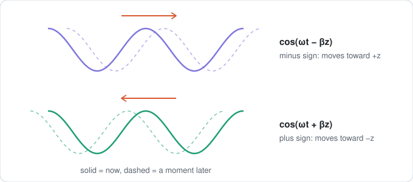

# Tired Brain

It's midnight. The exam is in four days. Last time you studied, you chewed through fifty slides and still couldn't start a single homework problem.

Skip the textbook. Hand Claude your homework. It hunts down the only equations your exam uses and feeds them to you in five-minute bites: one picture, three plain sentences, three easy questions.

You just follow along, and it soaks in by osmosis. 30 minutes in, you can already solve problem 1 on the exam.

## One bite

> **Chunk 2 · which way the wave goes**
>
> 
>
> **The picture shows one thing:** the sign in front of βz decides the direction.
>
> - A wave is written cos(ωt − βz). One part is about time, the other about position.
> - Look at the sign on the position part. Minus means it moves toward +. Plus means it moves toward −.
> - Here is why. Watch one crest. As time grows, z has to grow too for the bracket to stay the same, so the crest slides toward +z.
>
> **Quick quiz**
> 1. Which way does cos(ωt + 5z) move?
> 2. Which way does cos(ωt − 5x) move?
> 3. A wave moves toward −y. Is the sign minus or plus?

> **You:** −z, +x, plus
>
> **Claude:** All three right. Next is Chunk 3, frequency and speed.

That's the whole experience.

## The plan

```markdown
### Thu

| Item | Type | Topic | Done |
|---|---|---|---|
| HW5 Q4 | ✍️ | Speed of a wave in glass | ✅ |
| A3 | 📚 | Polarization |  |
| HW5 Q5 | ✍️ | Linear or circular |  |
```

📚 is a lesson. ✍️ is a homework problem you do closed-book. Every one the exam can draw on gets a row. The practice exam stays sealed until the last day.

## You hand over

- Homework or exam problems from a problem-solving course (physics, math, engineering, chem, stats, econ). Required.
- Slides, textbook, syllabus, equation sheet. Nice to have.
- How many days you've got.

## Install

```
/plugin marketplace add atomiiw/tired-brain
/plugin install tired-brain@atomiiw
```
